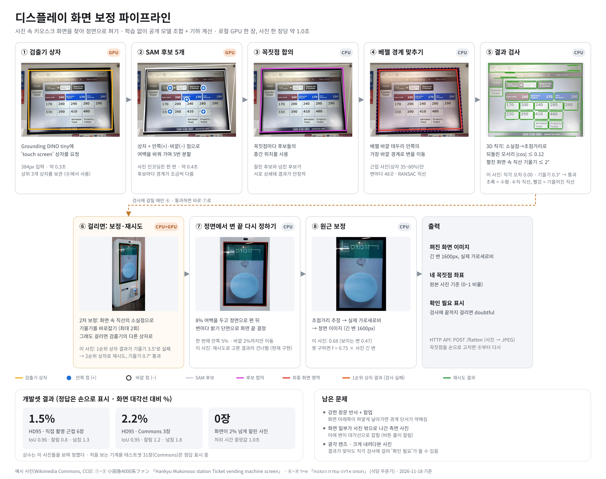

# 디스플레이 화면 보정 파이프라인

> 2026-11-18 기준 · 그림 원본: [rectify_pipeline.svg](rectify_pipeline.svg) · API 사용법: [api.md](api.md)

사진 한 장에서 키오스크 같은 디스플레이 화면의 네 꼭짓점을 찾고, 그 영역을 정면에서 본 직사각형 이미지로 펴는 파이프라인이다. 글자 인식(OCR)은 쓰지 않고 이미지만 다룬다. 새로 학습시킨 모델은 없다. 공개된 사전학습 모델을 조합하고, 그 위에 규칙과 기하 계산을 더했다.

- **입력:** 사람이 키오스크 앞에서 찍은 사진. 비스듬하고, 화면 테두리(베젤)와 기계 몸체, 주변 배경, 유리 반사가 섞여 있다.
- **출력:**
  - 화면만 정면에서 본 이미지와 네 꼭짓점 좌표. 원래 화면의 가로세로 비율도 되돌린다.
  - 결과를 믿기 어려우면 "확인 필요"로 표시한다.
- **속도:**
  - 로컬 GPU(Intel Arc B50) 한 장에서 펴기까지 사진당 약 1.0초(중앙값)다.
  - 검사에 걸려 다시 시도하는 사진은 1.7초쯤 걸린다.

*그림 1. ①~⑤는 검사를 바로 통과하는 사진(한큐 무코노소역 발매기 화면)이다. ⑥~⑧은 실제로 검사에 걸린 다른 사진(식당 벽걸이 주문기)이다. 1순위 상자의 결과가 화면 아래 카드 단말까지 내려가 기울기 검사(3.5°)에 걸렸고, 2순위 상자로 재시도해 통과했다(0.7°). 현재 구현은 재시도로 고른 결과에 ⑦을 적용하지 않아서 ⑦ 칸에는 변화가 없다. 아래는 개발셋 결과와 남은 문제다.*

---

## 1. 구성: 각 도구의 약점을 서로 메운다

이 문제는 성격이 다른 두 가지로 나뉜다.

1. **무엇이 화면인지 알아보기.** 화면과 베젤, 기계 몸체, 옆의 다른 키오스크, 카드 리더 같은 작은 화면, 붙은 안내문을 구분해야 한다.
2. **화면 경계를 정확히 따기.** 경계가 조금만 안쪽으로 들어가도 가장자리 버튼이 잘린다.

| 단계 | 쓰는 것 | 잘하는 것 | 못하는 것 |
|---|---|---|---|
| ① 첫 상자 | Grounding DINO tiny (글자로 물체를 찾는 검출 모델) | "touch screen"이 어디 있는지 빠르게 찾음 | 기울어지지 않은 상자만 줌. 비슷한 점수의 다른 화면과 헷갈림 |
| ② 경계 후보 | SAM ViT-B (Meta의 Segment Anything 분할 모델) | 힌트만 주면 경계를 픽셀 단위로 따냄 | 힌트가 조금만 달라도 결과가 크게 바뀜 |
| ③~⑧ 다듬기·검사·펴기 | 규칙과 기하 계산 | 후보를 합치고, 베젤에 맞추고, 직사각형이 맞는지 검사하고, 원근을 수학적으로 품 | 사진에 보이는 단서(밝기 경계, 직선)에 기댐 |

흐름을 한 줄로 쓰면 다음과 같다.

**검출기가 넉넉한 상자를 잡고 → SAM이 경계 후보를 여럿 만들고 → 후보를 꼭짓점별로 합치고 → 베젤 경계에 맞추고 → 직사각형이 맞는지 검사해서 → 아니면 고치거나 다른 상자로 다시 하고 → 정면에서 변 끝을 다시 정한 뒤 → 원근을 풀어 편다.**

---

## 2. 단계별 설명

### ① 검출기 상자 (GPU, 약 0.3초)

Grounding DINO tiny에 사진과 "touch screen. display screen. monitor."라는 글자를 주고, 점수가 높은 상자 3개를 받는다. 1등 상자로 시작하고, 나머지 둘은 ⑥의 재시도에 쓴다.

- **입력 크기:** 사진의 짧은 변을 384px로 줄여서 넣는다. 화면은 사진에서 큰 물체라 기본값(800px)과 정확도가 같거나 더 나았고, 속도는 2.5배 빨랐다.
- **이 단계가 하는 일:** 무엇이 화면인지 정한다. 상자는 베젤까지 넉넉하게 잡는 편이라, 상자 단계에서 화면을 잘라먹는 일은 드물다.
- **약점:** 화면이 여러 개면 헷갈린다. 예를 들어 체크인 키오스크에서는 모니터 아래 카드 리더의 작은 화면이 1등(0.405), 모니터가 2등(0.392)이었다. 이건 ⑤·⑥에서 잡는다.

### ② SAM 후보 5개 (GPU, 약 0.4초)

SAM은 이미지와 힌트(프롬프트)를 받아 해당 물체의 마스크를 돌려주는 분할 모델이다. 힌트는 ①의 상자로 자동으로 만든다.

- **박스:** 상자에 여백을 조금(2~7%) 더한다.
- **안쪽 점 (+) 5개:** 상자의 중앙과 가로세로 30%·70% 지점 4곳. "여기는 화면"이라는 뜻이다.
- **바깥 점 (−):** 상자 꼭짓점과 변 중점을 중심에서 1.35배 밖으로 민 위치. "여기는 화면 아님"이라는 뜻이다.
- **5가지 변형:** 점 힌트 + 박스(여백 4%, 7%) 2개, 박스만(여백 2%, 4%, 7%) 3개를 돌린다.
- **비용:** 무거운 이미지 인코딩은 사진당 한 번만 하고(약 0.2초), 힌트마다 가벼운 디코더만 다시 돌린다. 그래서 5번 돌려도 싸다.
- **마스크 → 꼭짓점:** 구멍을 메우고 가장 큰 덩어리의 볼록 껍질을 4각형으로 근사한다.

### ③ 꼭짓점 합의 (CPU)

후보 5개 중 하나를 고르지 않고, **꼭짓점마다 후보들의 중간 위치**를 쓴다. ①의 검출기 상자와 너무 어긋난 후보(상자와의 IoU 0.3 미만)만 뺀다.

- **IoU:** 두 영역이 겹친 넓이를 두 영역을 합친 넓이로 나눈 값이다. 1이면 완전히 같고, 0이면 전혀 안 겹친다.
- **여기서 비교하는 것:** SAM 후보 사각형과 ①의 검출기 상자다. 정답과 비교하는 게 아니라, SAM이 상자와 딴판인 물체(몸체 전체, 옆 기계)를 잡은 후보를 걸러내는 거름망이다. 파이프라인 안에서 IoU는 이것과 ⑥의 상자 중복 확인에만 쓰인다.

- **이유:**
  - 정답을 아는 상태에서 보면, 거의 모든 사진에 "안 잘리고 덜 넘치는" 좋은 후보가 있었다.
  - 하지만 정답 없이 그 후보를 집어낼 기준은 끝내 찾지 못했다. SAM 신뢰도, 경계 선명도, 가장 큰 후보, 경계 안팎 색 차이를 시도했다.
  - 잘린 후보는 안쪽에, 몸체까지 넘친 후보는 바깥쪽에 있다. 그래서 중간값을 쓰면 둘이 서로 상쇄된다.
- **연속값을 쓰는 이유:** 후보 꼭짓점 하나를 고르는 방식은 SAM 결과가 실행마다 미세하게 달라질 때 결과가 크게 튀었다. 그래서 좌표의 중간값을 그대로 쓴다.

### ④ 베젤 경계 맞추기 (CPU, 약 50ms, 근접 사진만)

키오스크 앞면은 **몸체(또는 배경) → 베젤 → 화면** 순서의 층 구조다. 각 변에서 이렇게 한다.

1. 변을 따라 48곳에서, 안쪽에서 바깥쪽으로 밝기를 훑는다.
2. 화면 안쪽 밝기를 기준으로 어두운 띠를 찾는다.
   - 이 띠는 베젤이고, 팝업이 떠 있으면 어두워진 화면 여백까지 포함한다.
   - 띠가 끝나고 몸체나 배경이 시작되는 곳이 **베젤 바깥 테두리**다.
3. 그 테두리보다 안쪽에 있는 밝기 경계 중 **가장 바깥 것**을 후보로 잡는다. 밝아지는 경계든 어두워지는 경계든 상관없다.
4. 48곳의 후보 중 한 직선으로 가장 많이 이어지는 것을 RANSAC으로 고른다. 지점의 45% 이상이 동의할 때만 채택한다.
5. 네 변의 직선끼리 만나는 점을 새 꼭짓점으로 쓴다.

- **"가장 바깥 경계"를 쓰는 이유:**
  - 주문 확인 같은 팝업이 뜨면, 팝업 테두리가 화면 테두리보다 더 선명하다.
  - 하지만 팝업 테두리는 항상 진짜 화면 테두리보다 안쪽에 있다. 그래서 베젤 안쪽에서 가장 바깥 경계를 고르면 팝업만 잘라내는 일을 피할 수 있다.
  - 대가로 베젤을 조금 더 포함하는 쪽으로 치우친다.
- **근접 사진에만 쓰는 이유:** 검출기 상자가 사진의 35~80%일 때만 이 단계를 돌린다. 멀리서 찍은 사진은 베젤이 몇 픽셀밖에 안 되고, 화면이 사진을 꽉 채우면 베젤이 사진 밖이라 오히려 화면을 잘라먹었다.

### ⑤ 결과 검사 (CPU, 약 40ms)

여기까지 나온 사각형이 정말 화면인지 세 가지로 검사한다. 하나라도 걸리면 ⑥으로 간다.

**1) 3차원 직각 검사 (직각 오차 ≤ 0.12)**

화면은 직사각형이지만, 사진 속 사각형은 원근 때문에 모서리가 직각이 아니어도 정상이다. 그래서 2차원 각도를 재지 않고, 3차원으로 되돌려서 잰다.
1. 마주 보는 변을 연장해 두 소실점을 구한다.
2. 두 소실점으로 카메라 초점거리를 역산한다. ⑧과 같은 Zhang–He 방법이다.
3. 초점거리가 휴대폰다운 범위(사진 긴 변의 0.45~3배)면 그 값을 쓰고, 아니면 일반 휴대폰 값(0.75배)을 가정한다.
4. 그 초점거리로 두 변의 3차원 방향을 되돌린 뒤 사이각의 |cos|을 잰다. 0이면 직각이다.

- **기준 0.12:** 잘 맞은 결과는 0.06 이하였다. 몸체로 번지거나 화면을 대각선으로 가로지른 실패는 0.12~0.17이었다.
- **한계:** 초점거리를 사각형 자체에서 구하기 때문에, 그 값이 휴대폰 범위 안에 들면 어떤 사각형이든 직각 오차가 0이 된다. 그래서 이 검사는 "어떤 휴대폰으로도 이렇게 찍힐 수 없는 사각형"만 걸러낸다. 엉뚱한 작은 사각형(예: 카드 리더 화면)은 통과할 수 있다. 그런 경우를 잡는 게 다음 검사다.

**2) 펼친 화면 속 직선 기울기 (≤ 2°)**

화면에 그려진 것(버튼, 메뉴 칸, 팝업 테두리, 글줄)은 모두 화면과 같은 평면에 있다. 그래서 제대로 펴면 이 직선들이 수평·수직이 된다.
- **재는 방법:** 사각형대로 펴 본 뒤 선분 검출기(LSD)로 긴 직선을 찾고, 수평·수직에서 벗어난 각도를 길이 가중 평균한다.
- **기준:** 제대로 편 결과는 0.3~1.2°이고, 2°를 넘으면 걸린다.
- **안 쓰는 경우:** 직선이 4개 미만이면 이 검사는 건너뛴다.

**3) 베젤 확인**

근접 사진인데 ④에서 네 변 중 2변 미만에서만 베젤 경계를 찾았다면, 모양을 확인하지 못한 것으로 본다.

### ⑥ 걸리면: 2차 보정과 재시도 (CPU + GPU, 걸린 사진만)

**2차 보정 (기울기 1.5° 초과 또는 직각 오차 0.12 초과일 때)**
1. 사각형을 6% 넓혀서 펴 본다.
2. 화면 속 긴 수평선들과 수직선들을 각각 모아 두 소실점을 구한다. 반사나 기울어진 그림처럼 소실점과 2° 넘게 어긋나는 선은 빼고 다시 구한다.
3. 두 소실점을 무한대로 보내는 보정 변환을 만들어, 보정된 정면 보기에서 사각형의 변을 수평·수직으로 맞춘 뒤 원래 사진으로 되돌린다.
4. 최대 2번까지 하고, 기울기가 0.5° 이상 줄어든 경우에만 채택한다.

**다른 상자로 재시도**
- 그래도 검사에 걸리면 ①의 나머지 상자(2등, 3등)로 ②~⑤를 다시 돌린다. 검출기의 다음 상자와 이미 시도한 상자를 비교해서, IoU가 0.9 이상이면 사실상 같은 상자라 건너뛴다.
- 통과하는 결과가 나오면 거기서 멈춘다. 상자 하나에 약 0.4초가 든다.
- 모두 걸리면 **기준을 가장 적게 넘은 결과**를 고른다. 넘은 정도는 "직각 오차 ÷ 0.12"와 "기울기 ÷ 2°" 중 큰 값이다(베젤 확인 실패는 1.01).
  - 예: 카드 리더 3.85(기울기 7.7°), 모니터 1.35(직각 오차 0.16), 모니터 안쪽 1.39 → 모니터를 고른다.
  - 이 결과는 "확인 필요"로 표시된다. 위 예는 광각 렌즈 왜곡 때문에 맞는 결과인데도 직각 오차가 기준을 조금 넘었다.
- **직각 오차만으로 고르지 않는 이유:** 위 1)의 한계 때문이다. 카드 리더의 직각 오차는 0이었다.

### ⑦ 정면에서 변 끝 다시 정하기 (CPU, 약 40ms, 근접 사진만)

검사를 통과했거나 바로잡힌 사각형은 원근이 맞다고 보고, 정면 보기에서 각 변이 끝나는 위치만 다시 정한다.

1. 사각형을 8% 여백을 두고 정면으로 편다. 진짜 테두리가 여백 안에 들어오게 하려는 것이다.
2. 각 변을 두 부분으로 나누고, 부분마다 변을 가로지르는 밝기 단면(행 또는 열의 중간값)을 만든다.
3. 바깥쪽으로 가며, 밝은 화면이 끝나고 어두운 띠(베젤, 팝업 주위의 어두워진 화면)가 시작되는 곳을 찾는다.
4. 띠 안에서 다음으로 밝아지는 지점(베젤 → 몸체) 전에 한 번 더 어두워지는 단계가 있으면, 가장 바깥 단계를 화면 끝으로 본다. 팝업 뒤 어두운 화면에서 베젤로 넘어가는 경계다.
5. 두 부분의 끝점으로 변의 직선을 다시 긋는다. 꼭짓점 하나만 베젤에 올라가 있어도 따로 돌아올 수 있다.

- **이동 상한:**
  - 안쪽으로 5%, 바깥쪽으로 2%까지만 움직인다. 더 크게 움직이려는 경우는 대개 팝업 테두리나 몸체였다.
  - 변이 밝은 몸체 위에 있고 베젤 띠 전체가 안쪽에 보이면, 안쪽으로 15%까지 허용한다.

### ⑧ 원근 보정 (CPU)

네 꼭짓점을 직사각형으로 옮기는 변환(호모그래피)은 OpenCV 함수 하나로 끝난다. 문제는 **결과 직사각형의 가로세로 비율을 모른다는 것**이다.

- **Zhang–He 방법:** 화이트보드 촬영 보정 논문의 방법이다. 마주 보는 변을 연장한 두 소실점에서 카메라 초점거리를 역산하고, 그 값으로 화면의 실제 가로세로 비율을 계산한다. 사진에 보이는 변 길이를 그대로 쓰는 것보다 비율 오차가 크게 줄어든다.
- **초점거리를 못 구하면:** 예를 들어 옆으로만 돌아서 찍어 소실점이 하나뿐이면, 일반적인 휴대폰 메인 카메라 값인 **f = 0.75 × 사진 긴 변**을 가정한다. 그것도 안 되면 보이는 변 길이 비율을 쓴다.
- **출력:** 긴 변 1600px로 편다.

---

## 3. 평가

### 지표

- **HD95 (주 지표):** 정답 화면 경계와 찾은 경계 사이 거리의 95번째 백분위다. 화면 대각선 대비 %로 나타내고, 낮을수록 좋다. 넓이 비율인 IoU와 달리 경계가 몇 % 어긋났는지가 바로 보인다.
- **IoU (참고용):** 여기서는 정답 화면 영역과 결과 영역을 비교한다. 근접 사진에서는 0.94~0.98로 차이가 잘 안 보여서, 판단에는 HD95와 잘림·넘침을 쓰고 IoU는 표에 참고로만 남긴다.
- **잘림 / 넘침:** HD95를 방향별로 나눈 값이다.
  - 잘림은 정답 경계 중 결과 밖으로 나간 부분이고, 넘침은 결과 경계 중 화면 밖(베젤·몸체)으로 나간 부분이다.
  - 가장자리 버튼이 사라지는 잘림이 넘침보다 치명적이라, 2% 넘게 잘린 사진 수를 따로 센다.
- **정답:** 손으로 표시했고, 정밀도는 1~2% 정도다. 팝업 뒤 어두운 가장자리처럼 경계가 희미한 사진은 오차가 더 클 수 있다.

### 데이터: 개발셋과 테스트셋

학습은 없지만, 위 상수들(35~80%, 0.12, 2°, 5%·2%·15% 등)은 개발셋 사진을 보며 손으로 정했다. 사람이 손으로 맞춘 것도 일종의 과적합이 될 수 있어서, 처음 보는 기계에서의 성능은 따로 모은 테스트셋으로 잰다.

| 묶음 | 구성 | 용도 |
|---|---|---|
| 개발셋 | 카페 주문 키오스크 앞에서 직접 찍은 근접 사진 6장(3장은 주문 확인 팝업) + Wikimedia Commons 사진 4장 | 상수를 정하고 실패를 고칠 때 본다 |
| 테스트셋 | Wikimedia Commons에서 고른 31장 (주문기, 각국 역 발매기, 공항 체크인, ATM, 셀프계산대, 자판기, 주유기 등) | 상수를 바꾼 뒤 확인용으로만 돌린다 |

- 테스트셋에서 실패를 보고 고친 사진은 개발셋으로 옮긴다. 예: 체크인 키오스크 사진(⑥ 재시도의 예: 카드 리더 → 모니터)은 테스트셋에 있다가, 재시도 규칙을 만드는 데 쓰여서 개발셋으로 옮겼다.
- 직접 찍은 6장은 공개 저장소에 넣지 않았다. 저장소의 `screen_bench.py`로 재현할 수 있는 건 Commons 사진뿐이다.
- 테스트셋 정답은 아직 표시 중이다.

### 결과 (개발셋, 정답이 있는 9장)

| 묶음 | IoU | HD95 | 잘림 | 넘침 | 2% 넘게 잘린 사진 |
|---|---|---|---|---|---|
| 직접 찍은 근접 6장 | 0.96 | **1.5** | 0.8 | 1.3 | 0장 |
| Commons 3장 | 0.95 | **2.2** | 1.2 | 1.8 | 0장 |

- **처리 시간:** 중앙값 1.0초(펴기까지)다.
- **오경보:** 9장 모두 검사를 통과해서 재시도가 일어나지 않았다.
- **입력이 조금 달라도 결과가 같다:** 사진을 다시 JPEG로 인코딩해서 넣어도 결과가 거의 같다. 다만 재인코딩하면 베젤 확인에 걸려 "확인 필요"가 뜨는 사진이 하나 있다(결과는 같음).

이전 방식(VLM으로 첫 상자를 잡는 방식)과 비교하면, 근접 사진에서 잘림이 10.4%에서 1% 아래로 줄었고 처리 시간은 3.8초에서 1초로 줄었다.

---

## 4. 지금 구조가 되기까지

1. **윤곽선 검출 (모델 없음):** 합성 화면에서는 잘 됐지만, 실제 사진에서는 배경의 다른 사각형을 잡았다. "무엇이 화면인지" 판단하는 모델이 필요하다는 결론이 나왔다.
2. **VLM(gemma4-12b) + SAM:** 느리고(3.9초) 우리가 겨냥하는 근접 사진에서는 오히려 부정확했다. 당시 같은 사진으로 비교했을 때 근접 사진의 HD95가 14.1%(잘림 10.4%)로, 검출기 방식(5.0%, 잘림 1.7%)보다 훨씬 나빴다. VLM이 메뉴 영역만 화면으로 보고 아래쪽 장바구니·결제 영역을 빼먹는 일이 잦았고, 같은 사진에도 답이 실행마다 달랐다. 기계 전체가 나온 먼 사진에서만 비슷한 수준이었다.
3. **더 빠른 첫 상자 찾기:** 같은 사진들로 비교했다.

   | 방식 | 결과 |
   |---|---|
   | 작은 VLM (gemma4-e4b, e2b) | 기계 전체가 나오는 사진에서 무너짐 |
   | SAM만 (가운데 점) | 기계 몸체 전체를 잡음 |
   | 공개 화면 검출 모델 (YOLO 계열, Hugging Face) | 근접 사진에서 화면을 거의 못 찾음 |
   | 문서 꼭짓점 모델 (DocAligner) | 화면 사진에서 꼭짓점을 거의 못 찾음 |
   | **Grounding DINO tiny** | 0.2~0.3초에 화면을 자르지 않는 상자를 줌. 이걸 채택 |
4. **후보 고르기 → 꼭짓점 합의:** 여러 선택 기준을 시험했지만 잘림이 줄지 않아, 후보를 합치는 방식으로 바꿨다.
5. **베젤 경계 맞추기:** 합의된 사각형은 베젤이나 몸체를 몇 % 포함했다. 그래서 베젤 구조를 이용해 변을 화면 경계로 옮겼다. 처음에는 "베젤 바로 안쪽의 첫 밝은 경계"를 썼는데, 팝업 화면에서 팝업 테두리를 잡았다. 그래서 "베젤 안쪽의 가장 바깥 경계"로 바꿨다.
6. **직각 검사 → 펼친 화면 검사 → 2차 보정:**
   - 처음에는 "디스플레이라면 3차원에서 모서리가 직각이어야 한다"는 검사만 넣었다. 그런데 비스듬하게 펴진 결과를 놓쳤다. 위 한계 때문이다.
   - 그래서 "펴고 나서 화면 속 직선이 수평·수직인가"를 함께 보게 했다.
   - 같은 직선들로 원근을 다시 추정해 바로잡는 2차 보정도 추가했다.
7. **정면에서 변 끝 다시 정하기:** ④만으로는 팝업 화면에서 화면 전체 대신 팝업 주변까지만 잡히거나, 반대로 몸체까지 넘치는 경우가 남았다. 정면으로 편 뒤 행·열 단위 밝기 단면으로 변 끝을 다시 정하게 했고, 이동 폭에 상한을 뒀다.
8. **재시도 규칙:**
   - 검출기 2등 상자로 다시 시도하는 방법은 처음에는 결과를 나쁘게 만들었다. 2등 상자가 더 크게 잡고도 검사를 통과했기 때문이다.
   - 이후 1등 상자가 카드 리더인 사진이 나왔다. 그래서 "기준을 가장 적게 넘은 결과"로 고르는 방식으로 다시 넣었다. 첫 결과가 통과하면 재시도는 일어나지 않는다.
9. **VLM과 합성 사진 제거:** 느리고 근접 사진에서 덜 정확해서 VLM 경로를 지웠다. 합성 사진은 실제 사진과 성질이 달라 평가에서 뺐다. 실사진만 쓴다.

---

## 5. 한계와 다음 단계

- **강한 창문 반사:** 화면 아래쪽이 하얗게 날아가면 경계 단서가 약해진다. 반사가 화면 대부분을 덮으면 변 하나만 경계를 찾고 결과가 비스듬해지는데, 이 경우는 대개 "확인 필요"로 잡힌다.
- **화면 일부가 사진 밖으로 나간 측면 사진:** 화면 아래쪽이 사진 밖으로 나가면 아래 변이 대각선으로 잡힌다. 키오스크는 아래쪽에 결제·담기 버튼이 많아서 치명적이다.
- **검사의 오경보:** 결과가 맞아도 직각 검사에 걸릴 수 있다.
  - 광각 렌즈로 찍은 사진, 화면 중심에서 벗어나게 잘라낸 사진이 그렇다. 렌즈 중심이 사진 가운데라는 가정이 깨진다.
  - 위에서 크게 내려다본 사진은 초점거리를 못 구해 보이는 변 비율로 편다.
- **검사를 통과한 오답:** 재시도는 검사에 걸린 결과만 바꾼다. 다른 물체를 잡았는데 우연히 직사각형으로 보여 검사를 통과하면 그대로 나간다.
- **재시도의 역효과:** 1순위 결과가 맞는데 베젤 확인 하나로 아슬아슬하게 걸리면, 재시도한 상자(기계 전체, 사진 테두리)가 검사를 통과해 오히려 나쁜 결과가 채택되는 경우가 테스트셋에서 2장 나왔다. 또 재시도로 고른 결과에는 2차 보정과 ⑦이 적용되지 않는다. 베젤 확인만 걸린 경우는 재시도하지 않고, 고른 결과에 ⑦까지 적용하는 쪽으로 고칠 예정이다.
- **베젤 바깥이 어두운 배경:** 베젤 바깥 테두리를 찾지 못해서, 팝업 옆의 어두운 여백이 잘릴 수 있다.
- **평가 데이터가 적음:** 정답이 있는 사진이 9장이고, 그중 6장이 같은 기종이다. 테스트셋 31장의 정답이 들어오면 처음 보는 기계에서의 성능을 잴 수 있다.
- **다음 단계:**
  - 테스트셋 정답 표시와 평가가 먼저다.
  - 경계 단서가 희미한 팝업·반사 화면은 규칙보다 학습이 맞다고 본다. 사진이 모이면 작은 분할 모델(예: YOLO 분할) 미세조정을 생각하고 있다.

---

## 6. 자주 받는 질문

- **"학습은 안 했나?"** 안 했다. 데이터가 거의 없는 탐색 단계라, 공개 사전학습 모델의 조합과 기하 계산으로 어디까지 되는지 보는 게 목적이었다. 대신 상수를 손으로 정한 만큼, 개발셋과 테스트셋을 나눠서 잰다.
- **"왜 로컬 서버인가?"**
  - 외부 AI API를 쓰면 사진마다 비용이 나온다.
  - 사진이 외부로 나가지 않아서 개인정보 측면에서도 유리하다.
  - GPU 한 장(Intel Arc B50, 16GB)에 검출기와 SAM을 올리고, GPU 메모리가 부족하면 CPU로 넘기는 보호 장치를 달았다.
- **"자동 결과가 틀리면?"** 꼭짓점을 손으로 고쳐서 ⑧부터 다시 돌릴 수 있다. 실험용 테스트 페이지에서 지원한다. 앱에서는 "자동으로 잡고, 확인 필요면 손으로 수정"하는 화면으로 쓸 수 있다.
- **"비율 복원은 어떤 가정에 기대나?"** 화면이 평평한 직사각형이고, 이미지 중심이 광학 중심이며, 픽셀이 정사각형이라는 가정이다. 휴대폰 원본 사진이면 대체로 맞다.
- **"API는?"** `POST /flatten`에 사진을 보내면 펴진 화면 JPEG가 온다. 자세한 내용은 [api.md](api.md)에 있다.
- **"OCR은?"** 이 파이프라인은 이미지만으로 끝나게 분리했다. 글씨 읽기는 펴진 화면 위에서 그다음 단계로 따로 돌린다.
